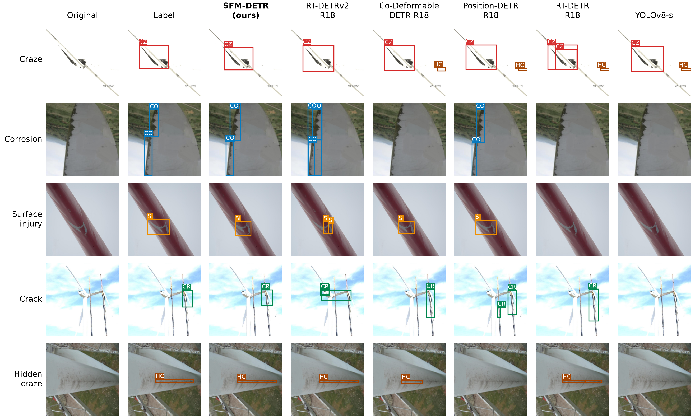
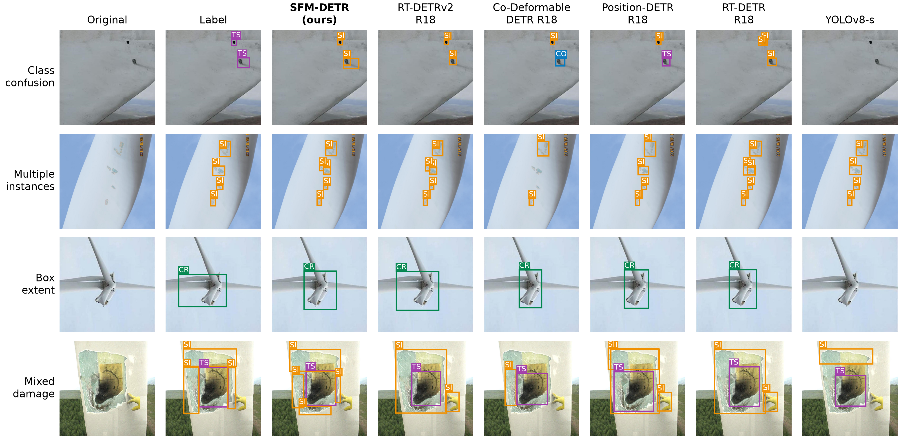
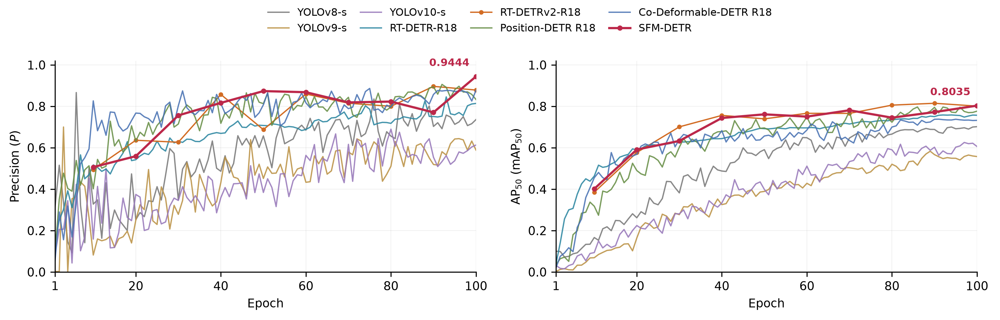
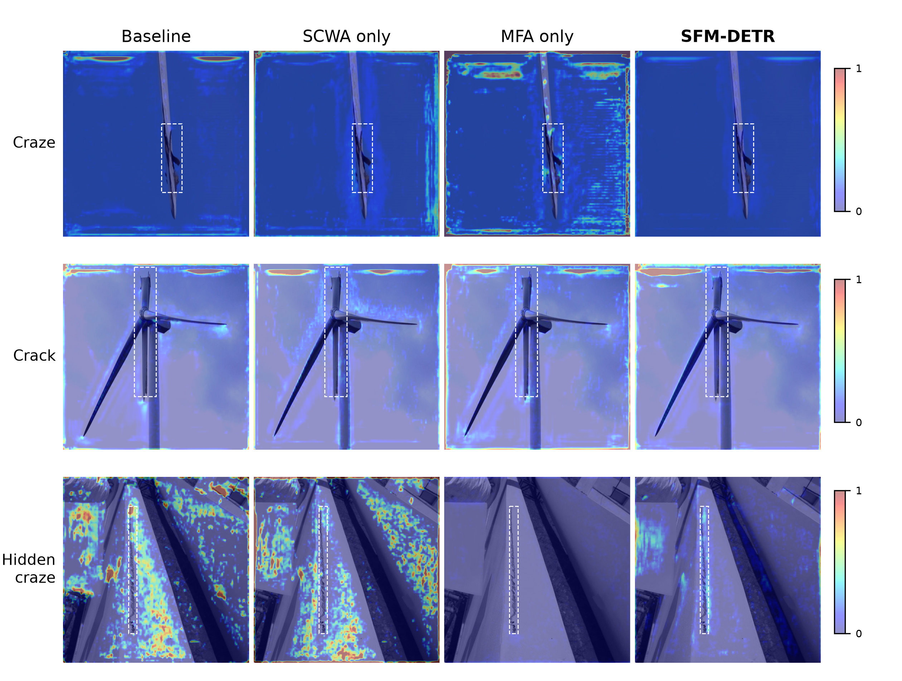

# SFM-DETR

**Semantic-Conditioned Wavelet Selection and Morphology-Aware Fusion for Wind-Turbine Blade Defect Detection**

本仓库提供论文定稿对应的 SFM-DETR 实现、训练配置、数据检查脚本和定稿实验图件。代码基于 RT-DETRv2 的 PyTorch 实现，并保留上游 Apache License 2.0 声明。

## 核心创新

1. **共享语义—频率—形态耦合。** SCWA 产生的四子带偏好 `D_l` 同时用于细节选择和粗尺度上下文采样，使两条特征路径具有一致的选择依据。
2. **SCWA（Semantic-Conditioned Wavelet Attention）。** 在同分辨率的四个 Haar 子带及其 3×3 邻域上执行语义条件注意力，保留带符号的高频响应并输出可解释的四通道偏好。
3. **MFA-Neck（Morphology-aware Frequency-guided Attention）。** 使用 `D_l` 生成采样偏置和注意力偏置，通过受约束的平移、旋转和各向异性尺度完成跨尺度融合。

## 目录

```text
src/                 SFM-DETR 与 RT-DETRv2 运行时代码
configs/sfm_detr/    WTBD/WTBs2025 的 full 与消融模板
tools/train.py       训练与验证入口
tools/prepare_config.py  将模板写成可运行配置
tools/validate_coco.py   COCO 数据检查
assets/              结构图、曲线、定性结果和困难样本
results/             定稿 Table 2 的三次运行汇总
docs/DATASETS.md     数据下载与目录说明
```

## 环境

```bash
python -m venv .venv
# Windows: .venv\Scripts\activate
# Linux/macOS: source .venv/bin/activate
pip install -r requirements.txt
```

训练需要 PyTorch 2.x、torchvision、CUDA 和 COCO 评估依赖；`requirements-deploy.txt` 仅用于 ONNX 导出/部署。建议使用 NVIDIA GPU。

## 数据准备

数据集下载链接如下，点击进入 Figshare 数据发布页面后下载文件：

| 数据集 | 下载链接 | DOI |
|---|---|---|
| WTBD | [WTBD 数据集下载](https://doi.org/10.6084/m9.figshare.30210175.v1) | `10.6084/m9.figshare.30210175.v1` |
| WTBs2025 | [WTBs2025 数据集下载](https://doi.org/10.6084/m9.figshare.28876391.v1) | `10.6084/m9.figshare.28876391.v1` |

下载后需按本项目的 COCO 目录要求准备数据，详见 [docs/DATASETS.md](docs/DATASETS.md)。原始数据不包含在仓库中。准备后先运行：

```bash
python tools/validate_coco.py /path/to/WTBD/coco
```

## 训练

先用模板生成本机配置。模板中的 `__DATA_ROOT_WTBD__` 或 `__DATA_ROOT_WTBS2025__` 会被替换为你提供的数据目录：

```bash
python tools/prepare_config.py \
  --template configs/sfm_detr/wtbd_full_r18_100e.yml.template \
  --data-root /path/to/WTBD/coco \
  --output configs/local_wtbd_full.yml \
  --output-dir ./runs/wtbd_full
python tools/train.py -c configs/local_wtbd_full.yml \
  -t /path/to/rtdetrv2_r18vd_120e_coco_rerun_48.1.pth \
  --use-amp
```

将 `wtbd` 替换为 `wtbs2025`、将模板替换为 `wtbs2025_full_r18_100e.yml.template` 即可训练第二个数据集。`baseline`、`scwa_only` 和 `mfa_only` 模板用于消融。中断后使用 `-r runs/.../last.pth` 恢复同一配置。

COCO 预训练权重可从 RT-DETRv2 官方发布页获得：
<https://github.com/lyuwenyu/RT-DETR>。本仓库不打包权重文件。

验证已有 checkpoint：

```bash
python tools/train.py -c configs/local_wtbd_full.yml -r runs/wtbd_full/last.pth --test-only
```

训练日志默认写入配置中的 `output_dir`；训练阶段可使用 EMA 进行验证，论文中的受控消融端点使用 raw epoch-100 权重。

## 定稿结果

表中 P/R/AP50/AP 为三个独立运行的均值 ± 样本标准差。AP50 是 IoU=0.50 下按类别平均的 COCO AP，也就是通常所称的 mAP50；AP 是 IoU 0.50:0.05:0.95 的平均 AP。DETR 的 P/R 使用 IoU=0.50 插值 PR 曲线的最大 F1 工作点，YOLO 保留其原生定义。

| Dataset | Model | P | R | AP50 (mAP50) | AP |
|---|---|---:|---:|---:|---:|
| WTBD | YOLOv8-s | 0.7441 ± 0.0138 | 0.7063 ± 0.0119 | 0.7342 ± 0.0302 | 0.4174 ± 0.0126 |
| WTBD | YOLOv9-s | 0.5604 ± 0.0368 | 0.5284 ± 0.0285 | 0.5434 ± 0.0368 | 0.3059 ± 0.0258 |
| WTBD | YOLOv10-s | 0.7003 ± 0.0874 | 0.6309 ± 0.0466 | 0.6903 ± 0.0599 | 0.3804 ± 0.0296 |
| WTBD | RT-DETR-R18 | 0.7973 ± 0.0416 | 0.6400 ± 0.0361 | 0.7414 ± 0.0147 | 0.4635 ± 0.0122 |
| WTBD | RT-DETRv2-R18 | 0.8005 ± 0.0469 | 0.6900 ± 0.0520 | 0.7832 ± 0.0046 | 0.4953 ± 0.0061 |
| WTBD | Position-DETR R18 | 0.8917 ± 0.0542 | 0.7489 ± 0.0051 | 0.7850 ± 0.0120 | 0.4293 ± 0.0097 |
| WTBD | Co-Deformable-DETR R18 | 0.8156 ± 0.0366 | 0.7117 ± 0.0100 | 0.7175 ± 0.0129 | 0.3995 ± 0.0191 |
| WTBD | SFM-DETR | 0.9444 ± 0.0183 | 0.6300 ± 0.0047 | 0.8035 ± 0.0109 | 0.4856 ± 0.0093 |
| WTBs2025 | YOLOv8-s | 0.4881 ± 0.0105 | 0.4357 ± 0.0071 | 0.4409 ± 0.0028 | 0.2926 ± 0.0042 |
| WTBs2025 | YOLOv9-s | 0.4273 ± 0.0092 | 0.4545 ± 0.0058 | 0.4377 ± 0.0033 | 0.2615 ± 0.0039 |
| WTBs2025 | YOLOv10-s | 0.5131 ± 0.0076 | 0.4458 ± 0.0061 | 0.4874 ± 0.0042 | 0.3439 ± 0.0021 |
| WTBs2025 | RT-DETR-R18 | 0.6872 ± 0.0087 | 0.5713 ± 0.0105 | 0.6361 ± 0.0057 | 0.4233 ± 0.0064 |
| WTBs2025 | RT-DETRv2-R18 | 0.7264 ± 0.0103 | 0.6611 ± 0.0064 | 0.6634 ± 0.0035 | 0.4306 ± 0.0046 |
| WTBs2025 | Position-DETR R18 | 0.8012 ± 0.0113 | 0.6893 ± 0.0092 | 0.7214 ± 0.0029 | 0.4473 ± 0.0051 |
| WTBs2025 | Co-Deformable-DETR R18 | 0.7478 ± 0.0054 | 0.6701 ± 0.0083 | 0.6585 ± 0.0038 | 0.4241 ± 0.0054 |
| WTBs2025 | SFM-DETR | 0.8324 ± 0.0093 | 0.7497 ± 0.0074 | 0.7813 ± 0.0046 | 0.4613 ± 0.0069 |

## 可视化结果

下图是论文定稿中的代表性样本对比。5×8 网格按“原图、标注、SFM-DETR、RT-DETRv2-R18、Co-Deformable-DETR R18、Position-DETR R18、RT-DETR-R18、YOLOv8-s”排列，样本按 SFM-DETR 表现较好的类别示例选择；它用于定性展示，不代表随机抽样性能估计。



困难样本和错误分析：



训练曲线与模块归因：





## 许可与引用

RT-DETRv2 上游代码按仓库附带的 Apache License 2.0 发布；上游版权和许可文本保留在 [LICENSE](LICENSE)。SFM-DETR 新增代码和实验配置随本仓库发布，使用前请同时遵守数据集提供方的条款。

如果本代码用于研究，请引用论文中的 SFM-DETR 条目，并同时引用 RT-DETR/RT-DETRv2 与所使用数据集论文。
